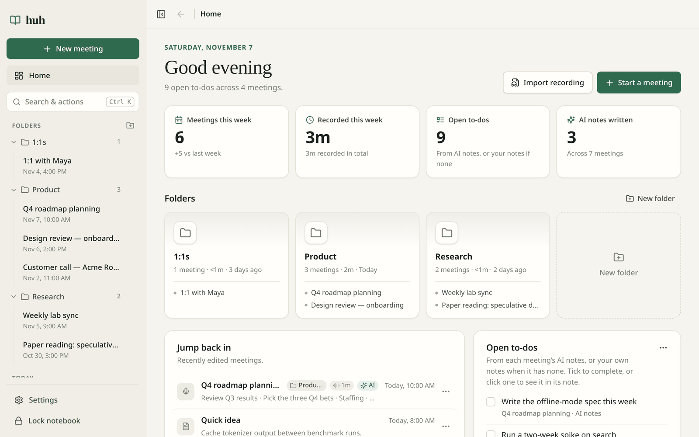
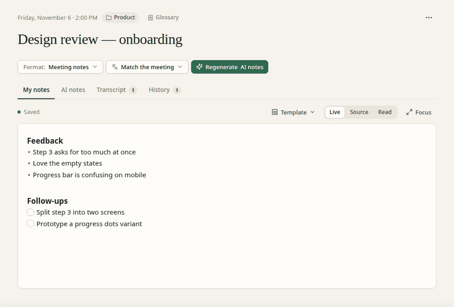
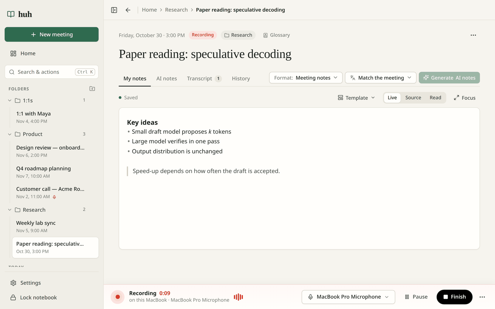
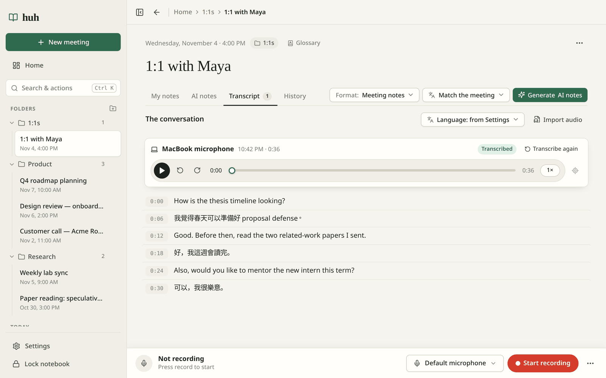
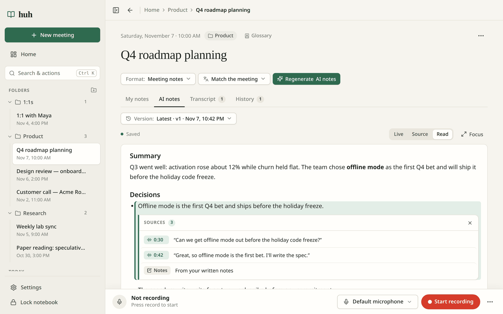
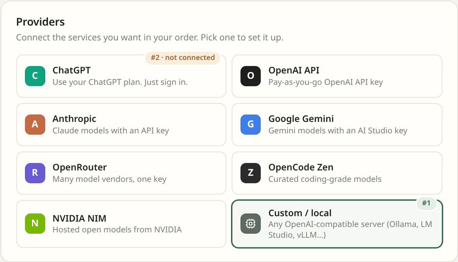
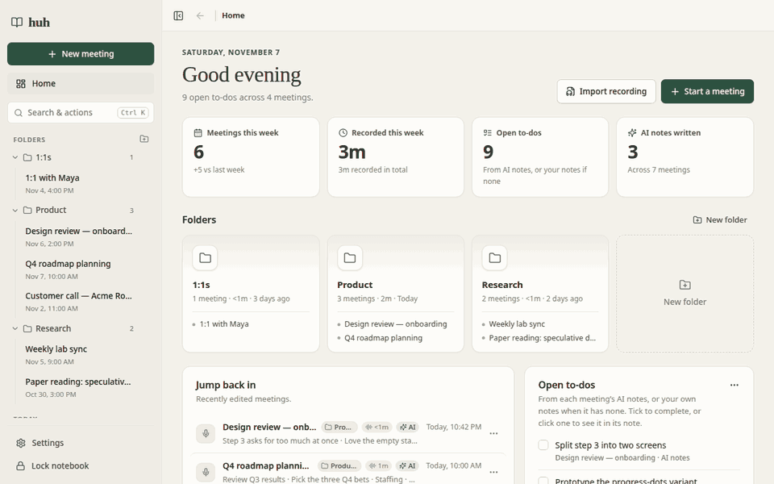
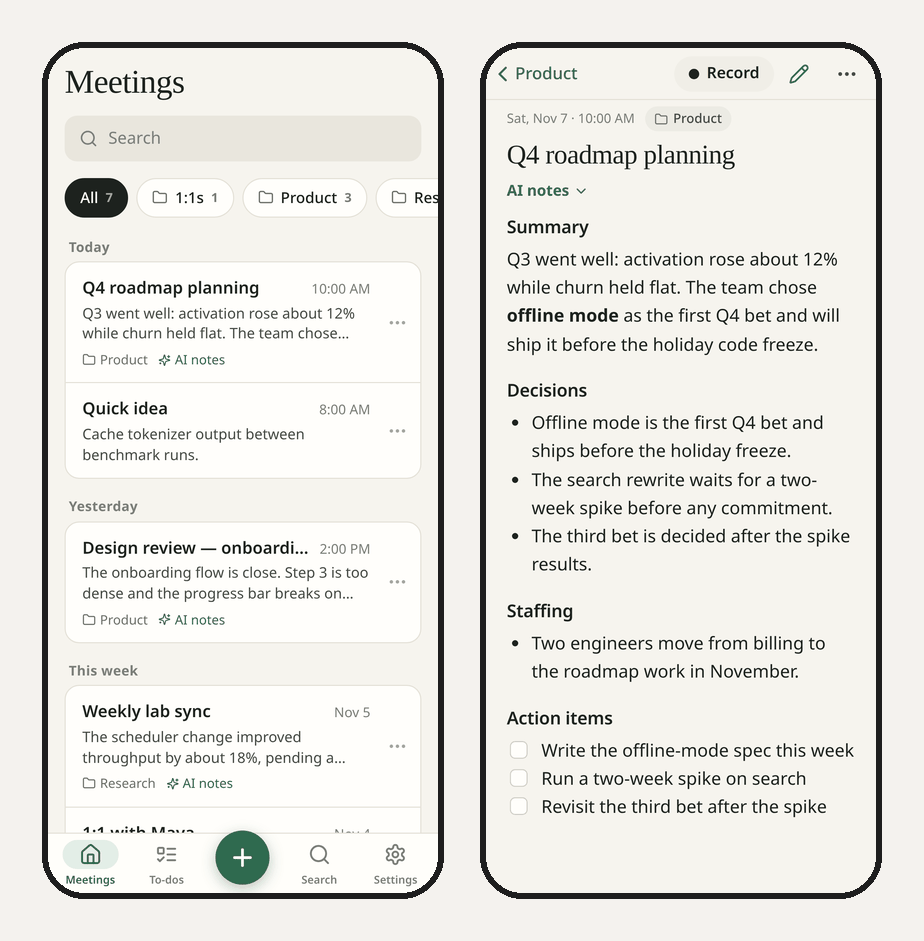

# Huh

**A self-hosted meeting notebook.** Take notes during a meeting, record from your laptop or phone, get a private transcript made on your own GPU, and turn your notes plus the transcript into clean AI notes. Every claim links back to what was said.



## Quick start

```bash
git clone https://github.com/chenkuanliao/Huh.git && cd Huh
./scripts/up.sh
```

Open **http://localhost:8787** and create your password. In **Settings**, pick an AI provider and a speech model. That's it.

You need Docker with Compose v2. An NVIDIA GPU makes transcription fast, but it's optional. See [Requirements](#requirements) and [Setup details](#setup-details).

## Features

### Notes first

Write Markdown that formats as you type: headings, bold, lists and checkboxes look finished while the raw syntax shows only on the line you're editing. There are also note templates, Tab/Shift+Tab indentation and a distraction-free focus mode.



### Record from any device

Start and stop from one device and record on another, for example your phone in the middle of the table. You can switch microphones mid-recording, add backup devices, and uploads resume if the network drops. You can also import a recording or a Voice Memo afterwards.



### Private, local transcription

Speech runs through [faster-whisper](https://github.com/SYSTRAN/faster-whisper) on your own machine (NVIDIA GPU, or CPU). It handles English, Chinese and meetings that mix both, with optional Traditional Chinese conversion. Audio never leaves your server.



### AI notes with sources

AI notes are written from your notes and the transcript. Sources are hidden in the text: right-click (or tap) any line to see exactly which moments of the meeting it came from, and click one to jump there. Every version is kept in History.



Bring whichever model you like: sign in with a ChatGPT plan, or use OpenAI, Anthropic, Google Gemini, OpenRouter, OpenCode Zen, NVIDIA NIM or any OpenAI-compatible/local server (Ollama, LM Studio, vLLM…). Put several in order, and if one runs out or fails, the next one takes over.

<p align="center"></p>

### Search and actions from the keyboard

Press **Ctrl/⌘+K** anywhere to jump to a meeting, folder or Settings page, or run an action (new meeting, import a recording, archive or move the open meeting…). Start with `>` for actions only. **Ctrl/⌘+F** finds text inside the open meeting.



### A real phone layout

On a phone, Huh becomes a simple list of meetings, your to-dos, a **Record** button on every meeting, and a clean reading view for each meeting.

<p align="center"></p>

### And also

- **Dashboard:** this week at a glance, recent meetings and every open to-do across meetings.
- **Folders and archive** to keep things tidy.
- **Glossary** per meeting, so the AI spells names and jargon right.

Huh is built for **one owner** on a home server, reached from your other devices over HTTPS (for example with Tailscale). It is not a multi-user hosted service.

## Requirements

- Docker Engine with Compose v2
- For GPU transcription: an NVIDIA GPU, its driver, and the [NVIDIA Container Toolkit](https://docs.nvidia.com/datacenter/cloud-native/container-toolkit/) (or the [host override](#gpu-without-the-nvidia-container-toolkit-linux) below)
- About 2–4 GB of disk for a speech model, downloaded on first use and cached

No API key is needed to start the app.

## Setup details

```bash
cp .env.example .env      # optional, defaults work for local use
./scripts/up.sh           # builds and starts db, app and worker
```

Open **http://localhost:8787**, create the owner password, then in **Settings**:

1. **AI notes:** pick a provider and sign in or paste an API key. Models load automatically.
2. **Transcription:** pick a speech model (Large v3 Turbo is a good default) and the spoken language.

### GPU without the NVIDIA Container Toolkit (Linux)

If the toolkit isn't installed, generate a local override that passes the GPU device nodes through and mounts the host driver libraries read-only. It doesn't change the host or the Docker daemon:

```bash
python3 scripts/configure-host-gpu.py   # writes compose.host-gpu.yaml (gitignored, host-specific)
./scripts/up.sh                          # picks the override up automatically
```

Re-run it after upgrading the NVIDIA driver.

### CPU only

```bash
docker compose -f compose.yaml -f compose.cpu.yaml up -d --build
```

Then choose **CPU** under Settings → Transcription → Advanced. Long recordings are much faster on a GPU.

### Using it from other devices

Browsers only allow microphone access over HTTPS (or on `localhost`). The simplest way is [Tailscale Serve](https://tailscale.com/kb/1312/serve) on the host:

```bash
tailscale serve --bg --https=8787 http://127.0.0.1:8787
```

Then put the HTTPS address Tailscale prints in `.env` and restart:

```ini
ALLOWED_ORIGINS=https://<your-machine>.<your-tailnet>.ts.net:8787
COOKIE_SECURE=true
```

The app and the OAuth callback listen on loopback only, and the database is never published. Every device signs in with the same owner password.

**Phones:** mobile browsers pause web recording when the screen locks or the browser goes to the background. Keep the screen on while recording on a phone, or record in Voice Memos and import the file afterwards (Share → Save to Files → Import audio).

### ChatGPT sign-in from another device

Sign-in redirects to `http://127.0.0.1:1457/…`, which only resolves on the server. When you sign in from another device, that last page will fail to load. That's expected: copy its full address into the box Settings shows you. Treat that address as a secret.

## Configuration

All settings are optional; see [`.env.example`](.env.example).

| Variable | Default | Purpose |
|---|---|---|
| `PORT` | `8787` | Local port for the web app |
| `CHATGPT_CALLBACK_PORT` | `1457` | Local port for the ChatGPT sign-in callback |
| `POSTGRES_PASSWORD` | `huh-local-database` | Internal database password (not exposed) |
| `SECRET_KEY` | generated | Encryption key for stored credentials; generated into the data volume if empty |
| `COOKIE_SECURE` | `false` | Set `true` when you only use HTTPS |
| `ALLOWED_ORIGINS` | — | HTTPS origin(s) used behind a TLS proxy such as Tailscale Serve |

For a local model server (Ollama, LM Studio, vLLM…) choose **Custom / local** in Settings and use `http://host.docker.internal:<port>/v1`.

## Data and privacy

- Docker volumes hold the database, audio and encrypted credentials (`data`), and speech models (`models`). `docker compose down` keeps them; `down -v` deletes them. Back up the database and data volumes together.
- Audio and transcripts stay on your server. Only the text sent for AI notes goes to the provider you choose (nothing does if you use a local model).
- API keys and ChatGPT tokens are encrypted at rest and never sent to browsers.
- Deleting a meeting removes its notes, AI notes and history, recordings, transcript, and the matching data on the device you delete from. A background sweep removes anything left unreachable after crashes.

Useful commands:

```bash
docker compose ps
docker compose logs --tail=100 app worker
```

If you use the GPU override, pass `-f compose.yaml -f compose.host-gpu.yaml` to Compose (`scripts/up.sh` does this for you).

## Development

| Path | What |
|---|---|
| `backend/app` | FastAPI API (`app.main:app`), worker (`python -m app.worker`), providers, OAuth |
| `backend/tests` | Backend tests (SQLite, no GPU needed) |
| `frontend/src` | React + TypeScript + Vite UI |
| `qa/` | Browser tests (Playwright) and a test-only mock LLM |
| `scripts/` | Start-up, GPU override and smoke-test helpers |
| `docs/images/` | Screenshots and GIFs used in this README |
| `SPEC.md` | API and behaviour contract |

```bash
# Backend
python3 -m venv .venv && . .venv/bin/activate
pip install -r backend/requirements.txt -r backend/requirements-test.txt
cd backend && python -m pytest -q

# Frontend
cd frontend && npm ci && npm run typecheck && npm test && npm run build
```

### End-to-end tests

The browser tests run against a separate, disposable stack (its own volumes and ports) so they never touch your real data:

```bash
docker compose -p huh-test -f compose.yaml -f qa/compose.test.yaml up -d --build
HUH_TEST_AUTH_FILE=.artifacts/test-auth.json python3 scripts/smoke.py http://127.0.0.1:18787   # creates the test owner
cd qa && npm ci && npx playwright install chromium && HUH_TEST_AUTH_FILE=../.artifacts/test-auth.json npm test
docker compose -p huh-test -f compose.yaml -f qa/compose.test.yaml down
```

Test audio lives in the gitignored `.artifacts/` folder: `jfk.flac` is the public-domain sample from the [openai/whisper](https://github.com/openai/whisper/tree/main/tests) repository, and `voice-memo.m4a` is the same clip converted with `ffmpeg -i jfk.flac -c:a aac voice-memo.m4a`. The test stack shares the `huh_models` volume so speech models aren't downloaded twice.

### Contributing

Work happens on branches and pull requests against `main`. Keep secrets, personal data and machine-specific files out of commits. `.gitignore` already excludes `.env`, `.artifacts/`, `compose.host-gpu.yaml` and local notes.

## License

[MIT](LICENSE) © 2026 Chen-Kuan Liao
